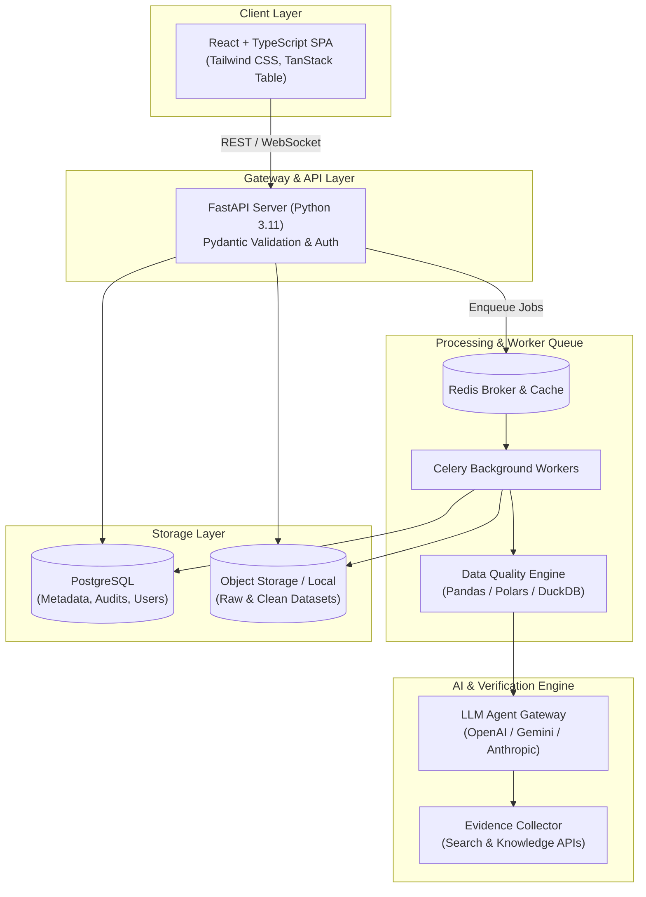

# TATVIK

> **AI-Powered Business Data Quality & Research Verification Platform**

[](#development-roadmap)
[](frontend)
[](backend)
[-lightgrey)](#license)

---

## 📌 Product Vision

**TATVIK** is an intelligent data governance and research verification platform engineered to help enterprises, analysts, and knowledge workers transform messy business datasets into trustworthy, verified insights.

In modern business workflows, critical decisions rely on tabular data exported from CRM systems, ERPs, scraped directories, and manual data-entry spreadsheets. However, real-world CSV and Excel files are riddled with:
- Duplicate and near-duplicate records
- Incomplete columns and missing contextual attributes
- Inconsistent date, currency, telephone, and address formats
- Contradictory records across distributed business units
- Unverifiable claims and unsupported factual assertions

**TATVIK** bridges this gap by marrying programmatic data cleansing rules with state-of-the-art LLM-powered semantic verification. It detects subtle anomalies, gathers and attaches verifiable research evidence, presents interactive diff reviews to human operators, tracks every change through an immutable audit trail, and exports pristine, production-ready datasets.

---

## 🚀 Key & Planned Features

### 1. Ingestion & Format Validation
- **Broad File Support**: High-performance parsing of CSV, TSV, XLSX, XLS, and JSONL formats with automatic delimiter and encoding detection (UTF-8, Latin-1, etc.).
- **Type & Schema Inference**: Automatic detection of column types (dates, integers, floats, emails, URLs, identifiers) with strict format validation.
- **Large Dataset Streaming**: Chunked ingestion pipeline designed to process large spreadsheets without memory exhaustion.

### 2. Intelligent Data Quality Engine
- **Fuzzy Deduplication**: Identifies exact and semantic duplicates across single or composite keys (e.g., matching `"Acme Corp Inc."` with `"Acme Corporation"`).
- **Missing Value Handling**: Context-aware imputation recommendations based on adjacent row values and statistical distributions.
- **Relational Consistency Verification**: Identifies logical contradictions (e.g., zip codes not matching states, start dates after end dates).

### 3. AI-Powered Anomaly Detection & Research Verification
- **Semantic Data Auditing**: Leverages Large Language Models to detect illogical row contents that programmatic regex rules fail to catch.
- **Research Evidence Linking**: Automatically queries trusted external databases, search APIs, or enterprise knowledge bases to verify corporate names, addresses, websites, and business registries.
- **Confidence Scoring**: Each suggested correction comes with an explainability metric and reference source citations.

### 4. Interactive Review & Correction Workspace
- **Side-by-Side Diff Inspection**: Visual interface highlighting original vs. suggested corrections before applying any changes.
- **Batch & Fine-Grained Approvals**: Accept, modify, or reject AI recommendations on a per-cell, per-row, or whole-column basis.
- **Manual Overrides**: Quick cell editing with real-time validation re-evaluation.

### 5. Audit Trail & Version Control
- **Immutable Change Logs**: Detailed history recording who changed what, when, and whether it was triggered by a human reviewer or an AI recommendation.
- **Dataset Checkpoints**: Rollback to any prior state or create branching versions for exploratory analysis.

### 6. Clean Dataset Export & Integrations
- **Multi-Format Export**: Download cleansed data in CSV, Excel (with formatted headers), Parquet, or JSON format.
- **Export Filters**: Export only verified rows, exclude unconfirmed changes, or include a companion validation report.
- **API Access & Webhooks**: Programmatic integration for CI/CD data pipelines.

---

## 🏗️ System Architecture



---

## 💻 Technology Stack

| Domain | Technology | Purpose |
| :--- | :--- | :--- |
| **Frontend Framework** | React 18 / TypeScript / Vite | High-performance, type-safe single-page interface |
| **UI Components & Styling** | Tailwind CSS / Lucide React / shadcn-ui | Modern, responsive, and accessible UI components |
| **Data Grid & State** | TanStack Table v8 / TanStack Query | Virtualized data tables for viewing large tabular files |
| **Backend Framework** | Python 3.11+ / FastAPI | High-throughput asynchronous REST API and validation |
| **Data Manipulation** | Polars / Pandas / DuckDB | Memory-efficient parsing, transformation, and deduplication |
| **Task Queue & Cache** | Celery / Redis | Background processing for large spreadsheet audits |
| **AI & Verification** | LangChain / LiteLLM / Embeddings | Prompt orchestration, entity verification, semantic checks |
| **Relational Database** | PostgreSQL + SQLAlchemy / Alembic | User management, dataset metadata, and audit logs |
| **Containerization** | Docker / Docker Compose | Reproducible local development and production deployments |

---

## 📁 Repository Structure

```text
tatvik/
├── .env.example              # Template environment configuration (no secrets)
├── .gitignore                # Production gitignore for React/TS + Python
├── README.md                 # Product documentation and setup guide
│
├── frontend/                 # React + TypeScript client
│   ├── public/               # Static assets
│   ├── src/                  # Application source code
│   │   ├── assets/           # Icons, images, stylesheets
│   │   ├── components/       # Reusable UI widgets & data tables
│   │   ├── hooks/            # Custom React hooks
│   │   ├── pages/            # View routes (Upload, Audit, Review, Export)
│   │   ├── services/         # API client & fetch utilities
│   │   ├── types/            # TypeScript data contracts & schemas
│   │   ├── App.tsx           # Root application component
│   │   └── main.tsx          # Application entrypoint
│   ├── package.json          # Node dependencies
│   ├── tsconfig.json         # TypeScript compiler configuration
│   └── vite.config.ts        # Vite build configuration
│
└── backend/                  # Python FastAPI service
    ├── app/
    │   ├── api/              # API route controllers
    │   ├── core/             # Configuration, logging, and security
    │   ├── db/               # Database session, models, and migrations
    │   ├── engine/           # Data quality rules & deduplication logic
    │   ├── verifier/         # AI verification agents & evidence fetchers
    │   ├── workers/          # Celery background tasks
    │   └── main.py           # FastAPI entrypoint
    ├── tests/                # Unit and integration test suites
    ├── requirements.txt      # Python dependencies
    └── pyproject.toml        # Python project configuration
```

---

## 🛠️ Getting Started & Setup Instructions

### Prerequisites
- **Node.js**: v18.0.0 or higher ([Download](https://nodejs.org/))
- **Python**: v3.11 or higher ([Download](https://www.python.org/))
- **Git**: Installed and configured
- **PostgreSQL & Redis**: (Optional for local dev, required for full background workers)

---

### Step 1: Clone & Environment Setup

```bash
# Clone the repository
git clone https://github.com/shubhamtale-dev/TATVIK.git
cd tatvik

# Create your local environment configuration
cp .env.example .env
```

> **Note**: Update `.env` with your preferred database credentials and LLM API keys. Never commit `.env` to Git.

---

### Step 2: Backend Setup (Python / FastAPI)

```bash
# Navigate to backend directory
cd backend

# Create and activate a Python virtual environment
python3 -m venv .venv
source .venv/bin/activate    # On Windows: .venv\Scripts\activate

# Install dependencies
pip install --upgrade pip
pip install -r requirements.txt

# Start the development server
uvicorn app.main:app --reload --host 0.0.0.0 --port 8000
```

The API documentation will be available at:
- **Interactive Swagger UI**: [http://localhost:8000/docs](http://localhost:8000/docs)
- **ReDoc**: [http://localhost:8000/redoc](http://localhost:8000/redoc)

---

### Step 3: Frontend Setup (React / TypeScript)

In a separate terminal window:

```bash
# Navigate to frontend directory
cd frontend

# Install dependencies
npm install

# Start the development server
npm run dev
```

The web dashboard will be available at:
- **Vite Local Server**: [http://localhost:3000](http://localhost:3000)

---

## 🗺️ Development Roadmap

- [ ] **Phase 1: Ingestion & Core Quality Engine (MVP)**
  - [x] Repository initialization & architecture setup
  - [ ] CSV & Excel streaming ingestion pipeline
  - [ ] Rule-based duplicate detection & missing value scanner
  - [ ] Format validation (date, currency, phone, email)
  - [ ] Initial export pipeline (cleaned CSV/XLSX)

- [ ] **Phase 2: AI Verification & Research Assistant**
  - [ ] LLM anomaly detection for unstructured text columns
  - [ ] Evidence verification agent integration
  - [ ] Confidence scoring & citation reference generator
  - [ ] Asynchronous task queue for long-running analyses

- [ ] **Phase 3: Interactive Review Workspace & Auditing**
  - [ ] Side-by-side diff review UI with TanStack Table
  - [ ] Cell-level accept/reject recommendations
  - [ ] Immutable audit log & version checkpointing
  - [ ] Role-based access control (Admin, Reviewer, Viewer)

- [ ] **Phase 4: Enterprise Integrations & Automation**
  - [ ] Connectors for Google Sheets, Salesforce, HubSpot, and Snowflake
  - [ ] Webhook triggers and automated scheduled audits
  - [ ] SOC2 / GDPR compliance reporting
  - [ ] Self-hosted deployment templates (Helm / Docker Compose)

---

## 🔒 Security & Data Privacy Guidelines

- **Zero Data Leakage**: Do not commit client datasets, production spreadsheets, or sensitive test data (`*.csv`, `*.xlsx`).
- **Secrets Management**: Keep all API keys, database credentials, and signing secrets in `.env`.
- **Data Retention**: By default, uploaded working files are stored securely in isolated tenant buckets and can be purged upon job completion.

---

## 📄 License

*All rights reserved.*  
An open-source license has not been selected for this repository at this time. The code and documentation within this project are proprietary and confidential unless explicitly stated otherwise.
